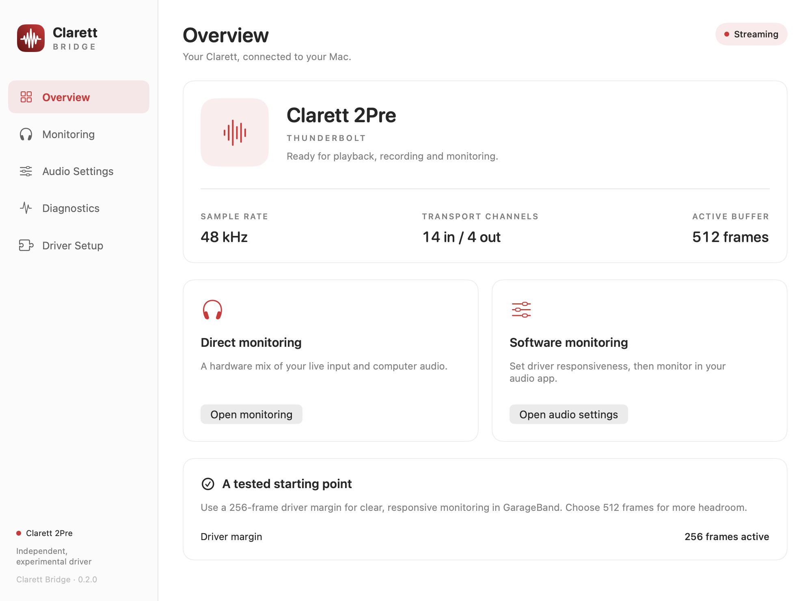
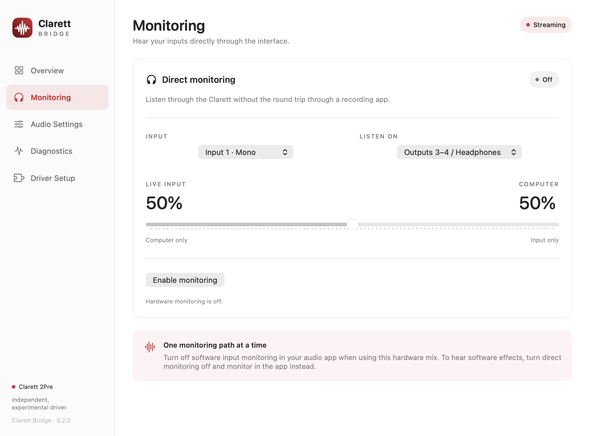

# Clarett Bridge

**An independent macOS driver and control app for the original Focusrite Clarett 2Pre Thunderbolt.**

Clarett Bridge connects this interface to Core Audio through DriverKit and AudioDriverKit. It provides playback, recording, hardware direct monitoring, selectable sample rates and adjustable driver margins while keeping Full Security enabled on the tested Mac.

## Why this exists

The original Clarett 2Pre Thunderbolt is still a useful audio interface, but its official macOS driver uses a kernel extension. On Apple silicon, [Focusrite's installation instructions](https://support.focusrite.com/hc/en-gb/articles/360021637879-Installing-the-Clarett-Thunderbolt-driver-on-Apple-Silicon-systems) require booting into Recovery, selecting **Reduced Security**, and allowing user management of kernel extensions. That changes the Mac's startup security policy; it is not simply permission to connect a Thunderbolt accessory.

Clarett Bridge was created to keep this hardware usable **with Full Security enabled**, without a trip through Recovery or changes to device-management policy. It replaces the kernel extension with a user-space DriverKit/AudioDriverKit driver and a native control app. This worked on the development Mac without IT involvement; signing, normal macOS extension approval and any management policies still apply on other Macs.



*Representative interface preview. Readiness, active settings and diagnostics in the app come from the connected device; this image uses example values.*

## Current status

This is an **experimental source release**, tested on one Clarett 2Pre Thunderbolt with an Apple silicon Mac running macOS 27.0.1 and Xcode 27. It is independent of Focusrite and is not endorsed by the manufacturer.

| Feature | Result |
| --- | --- |
| Driver activation and PCI attachment | Passed with user-confirmed Full Security; SIP enabled |
| Playback and recording | Clear Spotify playback and Audacity recording/listen-back |
| Software monitoring | Clean, acceptably responsive monitoring in GarageBand at a 256-frame driver margin |
| Hardware direct monitoring | Input 1/2 or stereo mix, selectable output pairs and live/computer blend; manually verified |
| Sample rates | 44.1, 48, 88.2 and 96 kHz implemented, internal clock; new rate transitions await hardware validation |
| Transport channels | 14 capture / 4 playback; 10 capture slots are live at 88.2/96 kHz; these are not physical socket counts |
| Margins below 256 frames | Unreliable: crackling observed at 64 and 128 frames |
| MIDI, 176.4/192 kHz, external clocks, Focusrite Control | Not implemented |

The verified software-monitoring test used an **effective 512-frame Core Audio buffer**. Selecting a requested buffer in the app does not guarantee another audio application will use it. Numerical round-trip latency, sustained load and sleep/wake are not yet qualified. See [validation](docs/validation.md).

## Build and install

There is no broadly installable signed binary in this release. A developer build requires Xcode 27 / DriverKit 27, an Apple Developer team, and provisioning with the DriverKit, PCI and audio-family development entitlements. The current driver deployment target is macOS 27.

```sh
git clone https://github.com/jthrilly/clarett-bridge.git
cd clarett-bridge
bash scripts/test.sh
scripts/build.sh audio DEVELOPMENT_TEAM=YOUR_TEAM_ID -allowProvisioningUpdates
python3 scripts/verify-signing.py 'build/audio/Build/Products/Debug/Clarett Bridge.app'
```

New developers must register their own bundle identifiers and capabilities; see the [complete build and signing guide](docs/building.md). Install the verified app in `/Applications`, open **Driver Setup → Activate driver**, and complete the normal macOS approval flow. Keep Full Security and SIP enabled. Device-management approval policy may differ on other Macs.

The app is now named **Clarett Bridge**. Existing driver identifiers and device identity retain the earlier `ClarettProbe` name for installation compatibility. The Xcode project and scheme are still named `ClarettProbe`. Host build 14 (0.2.0) can operate the existing version 12 audio driver, but changing sample rate requires activating audio driver version 13. Driver version 12 remains the previous audio-tested baseline.

## Use it

1. Select **Clarett 2Pre Thunderbolt (Experimental)** as the input and output in your audio app.
2. To change rate, open **Audio Settings → Sample rate**. Turn direct monitoring off, select 44.1, 48, 88.2 or 96 kHz and click **Apply rate**. Check the active value; both input and output share this rate.
3. For **software monitoring and effects**, use **Audio Settings → Driver responsiveness → 256 frames** and enable monitoring in your audio app. GarageBand passed the manual listening test. Turn hardware monitoring off for this path.
4. For **hardware direct monitoring**, open **Monitoring**, choose inputs and outputs, adjust the live/computer blend, then enable monitoring. Turn the audio app’s software monitoring off to avoid two delayed copies.
5. Check the **active** buffer value after a request. Audio apps may override it. The driver margin resets to 512 when the device reattaches; choose 256 again if desired.

Audacity 4.0.1’s software-monitoring path requests its audio library’s high input-latency hint, which was 100 ms on the test Mac even with Audacity’s buffer preference at 10 ms. That is separate from driver crackling at smaller margins. See [monitoring and latency](docs/monitoring-controls.md).



*Representative monitoring preview; changes are applied explicitly and the resulting route/mixer state is read back.*

## Documentation

- [User guide](docs/user-guide.md): monitoring, buffers, driver setup and removal.
- [Build and signing](docs/building.md): requirements, identifiers, entitlements and build stages.
- [Architecture](docs/architecture.md): host, PCI/mailbox, DMA, audio timeline and configuration changes.
- [Monitoring and latency](docs/monitoring-controls.md): mixer preservation, runtime profiles and app buffering.
- [Validation and limitations](docs/validation.md): exactly what has been tested.
- [Troubleshooting](docs/troubleshooting.md): no hardware, silence, crackling, delay and activation issues.
- [Initial feasibility](docs/feasibility.md) and [historical mailbox result](docs/hardware-test-2026-10-21.md).
- [Contributing](CONTRIBUTING.md) and [third-party provenance](THIRD_PARTY.md).

## Command-line tools

```sh
zsh scripts/audio-configure.sh rate 44100   # Request; verify hardware/stream readback
zsh scripts/audio-status.sh                 # Read-only device/client report
zsh scripts/audio-configure.sh margin 256   # Briefly restarts existing I/O
zsh scripts/audio-configure.sh buffer 128   # Request; verify actual result
bash scripts/package-source.sh HEAD         # ZIP and tar.gz of committed source
```

CI runs sanitized C++ protocol/ring/mixer/sample-rate tests, checks generated project files, and type-checks the SwiftUI host. It does not sign, activate a driver or validate audio hardware. The project includes no credentials, provisioning profiles, certificates, private keys or device UDIDs.

## License and provenance

[GPL-2.0-only](LICENSE). Protocol research and the reference Linux driver are credited in [THIRD_PARTY.md](THIRD_PARTY.md). No Focusrite binary was modified or disassembled. Focusrite and Clarett are their owners’ trademarks.
