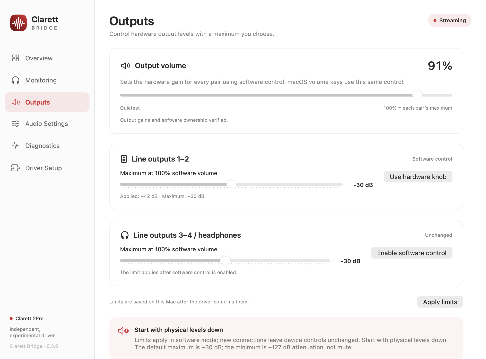

# Output volume and maximum levels

Clarett Bridge 0.3.0 adds a hardware-backed Core Audio output volume control and an **Outputs** page. It requires audio driver **15** (host build **16**). This is an experimental implementation: command/readback validation and a manual listening check are separate milestones; see [validation](validation.md).



*Representative UI preview with example values, not a live hardware measurement.*

## Using the controls

1. Stop audio and turn physical monitor/headphone levels down before the first test.
2. In **Outputs**, choose the maximum for **line outputs 1–2** and/or **line outputs 3–4 / headphones**. The range is −60 to 0 dB, in hardware steps of 1 dB; the default is −30 dB. Negative values are attenuation relative to the interface's unity gain, not sound pressure levels.
3. Click **Enable software control** for the pair you use. Its chosen ceiling is sent in the same request as takeover. The driver stages and verifies the −127 dB hardware floor before releasing the pair from knob control. Takeover also cannot be louder than the current live monitor-knob position. Move the software volume up deliberately after takeover.
4. The main slider and macOS volume keys adjust the same standard Core Audio control. They affect every pair with software control enabled. Each pair has its own maximum; pairs left unchanged are not deliberately reassigned to software control.
5. To change a ceiling later, click **Apply limits**. Lowering it attenuates immediately if needed. Raising it preserves the current physical level by reducing the common logical volume; turn the main slider up separately to use the extra range. A shared slider means preserving one pair can also make the other quieter.
6. **Use hardware knob** returns a controlled pair to physical ownership. The driver refuses if the live knob position is louder than that pair's current software level. Turn the monitor knob fully down and try again. Once in hardware mode, its software ceiling no longer governs output level.

The app saves confirmed ceiling preferences on this Mac. It does not save gains or ownership to the interface's flash. Closing the app leaves an enabled driver and its current limits working, including macOS volume changes. On driver reattachment, software ownership is not automatically asserted: select it again to apply your saved ceiling atomically. Warm reconnects can retain the previous volatile device settings, while the new driver describes unasserted ownership as **Unchanged** rather than guessing it from boot-time config bytes. A cold power cycle returns the device to its saved configuration.

Minimum software volume selects the device's −127 dB attenuation floor. This is **not a hardware mute**. No master mute/dim or physical headphone-amplifier controls are rewritten. The ceilings govern the interface's digital output gain while software ownership is enabled; they cannot calibrate acoustic loudness or constrain a physical knob after returning control to it.

## Hardware protocol and safety boundary

The [protocol research](https://github.com/JustALawnGnome7/clarett-sre/blob/4df059996ecf781f5603f5395d6fe1bf6d56c1f7/spec/clarett-interface.md) identifies:

| Command/data | Purpose |
| --- | --- |
| GET_DATA `0x800000` | Read exact gain, ownership and live knob bytes |
| SET_DATA `0x800001`, offsets 32/33 and 36/37 | Stereo output attenuation codes; 0 = unity, 127 = −127 dB |
| DATA_CMD `0x800002`, code 1 | Apply volatile output gains |
| SET_DATA, bytes 52 and 56, bits 0/1 | Per-pair hardware-gain ownership; clear for software, set for knob |
| DATA_CMD, code 3 | Apply volatile ownership flags |
| GET_DATA, offset 112 | Read the live monitor knob; never written by this driver |

Focusrite also documents assigning outputs to software faders by disabling their monitor-knob assignment in its [Clarett Thunderbolt Control guide, Monitor Controls](https://fael-downloads-prod.focusrite.com/customer/prod/s3fs-public/downloads/Focusrite%20Control%20Clarett%20Thunderbolt%20User%20Guide%20V2.pdf). That corroborates the capability, but does not qualify this implementation's audible behavior.

All requests pass through the driver's serialized mailbox queue. The allowed SET_DATA locations are exactly the two stereo gain pairs and their two ownership bytes. Values and lengths are bounded; only commit codes **1** and **3** are permitted. Flash commit code **5**, writes to the knob, arbitrary config access and other controls remain forbidden. The sample-rate handshake holds the same control-ownership guard, so it cannot interleave with volume commands. No mailbox transactions run in PCM callbacks.

The driver stores the ceiling and computes `hardware attenuation = min(127, ceiling attenuation + logical attenuation)` on **every** level change, including standard Core Audio requests. Thus full software volume with a −20 dB ceiling writes code 20, never code 0. The app cannot bypass this by moving its slider or sending a raw control dictionary. NaN/out-of-range values are rejected; fractional dB requests round toward greater attenuation.

Every write is acknowledged, committed, then read back before reporting a verified state. A failed write/readback blocks further output changes, with best-effort attenuation only if the transport remains usable. A timed-out/uncertain mailbox is terminal and never reused for a rollback or a later command. The app checks a new completion revision, not just an accepted request or an old status value. Config-byte readback confirms the bytes written in this session; it is not an independent acoustic measurement and cannot reveal the device's initial physical ownership after boot.

## Diagnostic utility

The utility never starts audio, records, changes default devices or modifies security settings. **Configure/level/scalar commands change output settings**; only `status` is read-only.

```sh
zsh scripts/output-control.sh status
zsh scripts/output-control.sh configure 1 60 60  # Own pair 1–2 quietly, ceiling −60 dB
zsh scripts/output-control.sh level 0               # Full logical volume, still at the −60 dB ceiling
zsh scripts/output-control.sh scalar 50              # Standard Core Audio scalar, like system volume
zsh scripts/output-control.sh status
```

`configure MASK CAP12 CAP34` uses mask 1 for pair 1–2, 2 for pair 3–4, 3 for both, or 0 to return any controlled pairs to the knob. Caps are positive attenuation codes 0–60. Configuration preserves the driver’s current logical volume; only a separate standard level/scalar request can change it. A return to the knob can be refused. Requests are asynchronous: wait for a newer `ClarettVolumeRevision`, `Pending=0`, `Uncertain=0`, `Status=verified`, then check enabled/known flags, ceiling and hardware-attenuation fields. Hardware fields describe the driver's verified gain only for software-enabled pairs with no uncertainty.
